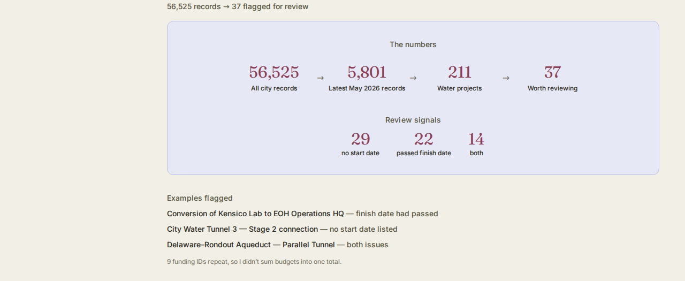

# NYC Water Project Health Dashboard

An independent analysis of NYC's Capital Projects Dashboard data, narrowing
tens of thousands of citywide project records down to a focused, reviewable
list of the city's water infrastructure projects worth a closer look.

## What this project is

A self-directed data cleaning and analysis project using NYC's public
Capital Projects Dashboard data (citywide budget and schedule), scoped
to the latest reporting period and to DEP — the agency that manages
NYC's water and environmental-protection infrastructure. It includes
the full filtering/validation pipeline (as Python scripts), the
resulting datasets, and the dashboard built to present the findings.

## Why I built it

I'm interested in how data can surface important signals buried in
thousands of records. NYC's Catskill and Delaware systems supply about
90% of the city's drinking water[^1], which made water infrastructure
feel like a meaningful place to see how data could help focus
attention on projects worth reviewing.

[^1]: NYC Department of Environmental Protection, ["Newly Updated
Filtration Waiver Confirms Success of Ongoing Efforts to Provide
Highest Quality NYC Tap Water"](https://www.nyc.gov/site/dep/news/22-040/newly-updated-filtration-waiver-confirms-success-ongoing-efforts-provide-highest-quality-nyc):
"The Catskill and Delaware systems comprise the largest unfiltered
water supply in the United States, delivering about 90 percent of New
York City's water on a typical day."

## What I did

- Narrowed 56,525 city project records to 5,801 from the latest
  reporting period, then to 211 water projects and 37 that needed a
  closer look.
- Defined two review signals: missing start dates and finish dates
  that had already passed.
- Checked repeated funding IDs so the same project wasn't accidentally
  treated as separate spending.

## Tools used

**In this repository:** Python · Pandas — the full filtering and
validation pipeline in `analysis/`.

**For the interactive dashboard on my portfolio (not included in this
repository):** Next.js · React · TypeScript. This repo contains the
data analysis and a screenshot of the resulting dashboard, not the
frontend source.

## Key findings

- **56,525 → 5,801 → 211 → 37** — city-wide project records narrowed
  to the latest reporting period, then to DEP's water-infrastructure
  projects, then to the records worth a closer look
- **29 records** are missing a start date
- **22 records** have a finish date that had already passed as of the
  start of the reporting month
- **14 records** meet both signals — so the total worth reviewing is
  **37**, the union of the two signals, not the sum (29 + 22 − 14 = 37)
- **9 funding IDs (FMS IDs)** repeat across more than one project
  within the 211-record scope, so budgets were not summed into one
  total — doing so would double-count shared funding lines
- Being flagged means a record met one of the two defined signals and
  is worth a closer look — it is not a claim that the project is
  failing, delayed, or over budget

Full detail, including the complete data-quality table and the agency
comparison behind selecting DEP, is in
[`docs/methodology.md`](docs/methodology.md).

## Data and validation notes

- Source: NYC Capital Projects Dashboard — Citywide Budget and
  Schedule, verified against the publisher's own data dictionary
  (included at [`docs/Capital_Projects_Dashboard_Data_Dictionary.xlsx`](docs/Capital_Projects_Dashboard_Data_Dictionary.xlsx))
- Scope: latest reporting period (May 2026), records whose Current
  Phase matches one of the five standard values the data dictionary
  defines, narrowed to DEP
- The 5,801 latest-period records are not described as "active" or
  "in-progress" anywhere in this project — the data dictionary doesn't
  establish that status, so this project doesn't claim it either
- No project failure, delay, cost overrun, or performance claim is
  made anywhere in this project — every number is a direct count or
  calculation from the source CSV, reproducible with the scripts below
- Full data-source documentation: [`data/DATA_SOURCE.md`](data/DATA_SOURCE.md)

## Dashboard



## How to reproduce this

```bash
git clone https://github.com/harjotsandhu24/nyc-water-project-health-dashboard.git
cd nyc-water-project-health-dashboard
pip install -r requirements.txt

cd analysis
python phase1_verify.py        # inspect the raw file, confirm reporting periods
python phase1b_latest.py       # isolate the latest reporting period -> 5,801 records
python phase4_review_scope.py  # apply the standard-phase rule + compare agencies
python phase5_scope_dep.py     # isolate DEP's 211-record scope -> ../data/dep_active_scope.csv
python phase5b_attention.py    # missing-start-date rule + other checks -> ../data/dep_with_flags.csv
python phase6_forecast_rule.py # finish-date rule + union/overlap -> ../data/dep_with_flags_v2.csv
```

Each script prints its results to the terminal so they can be checked
against the numbers in this README and in `docs/methodology.md`.
